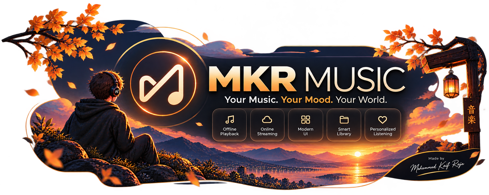
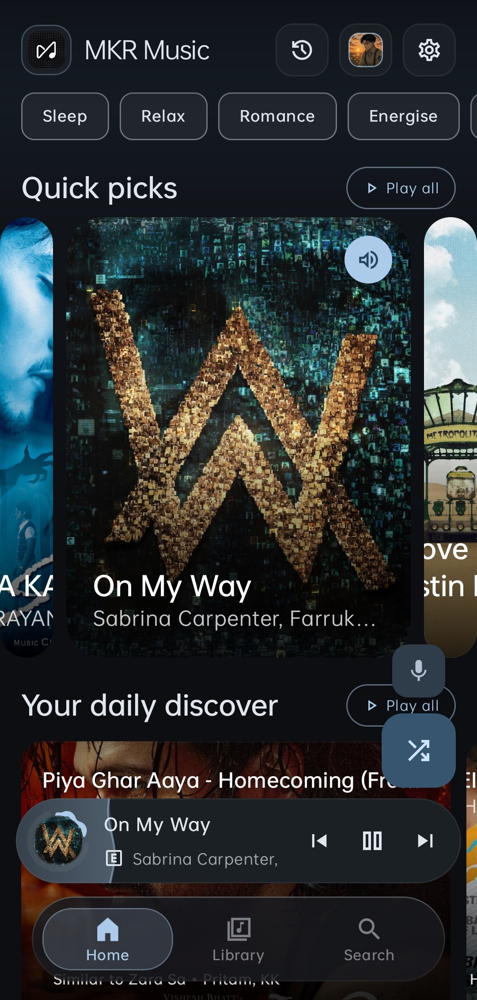
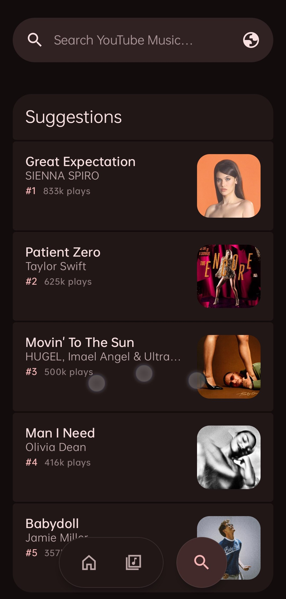
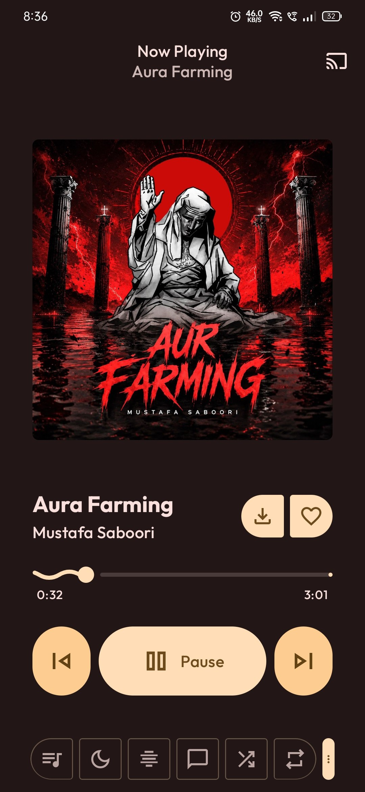
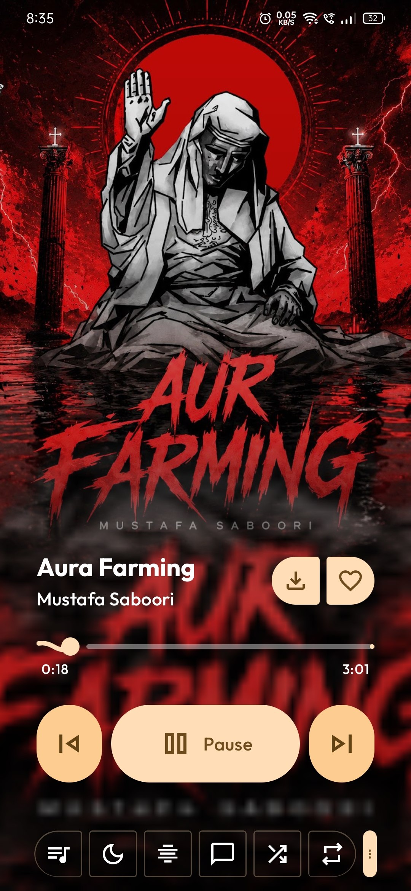
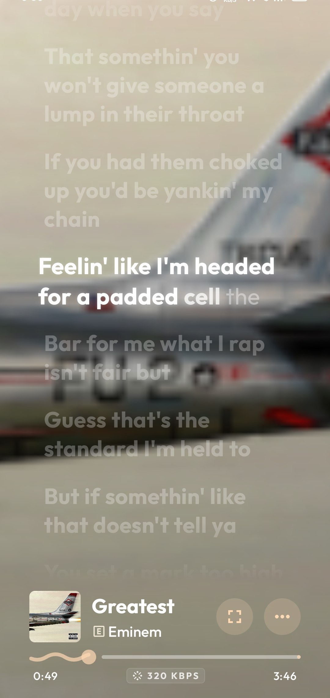
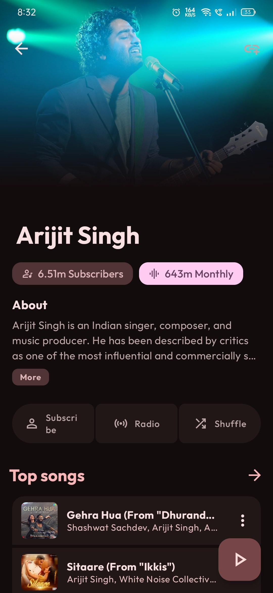
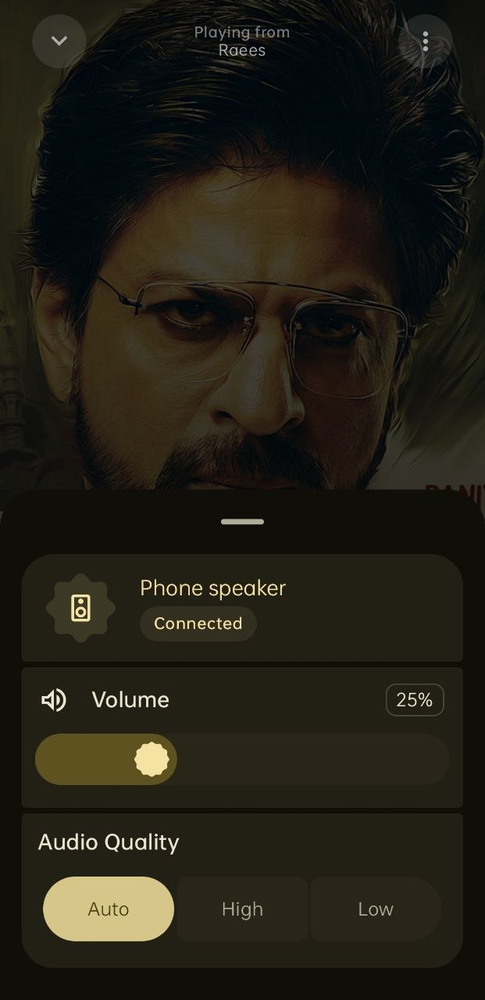
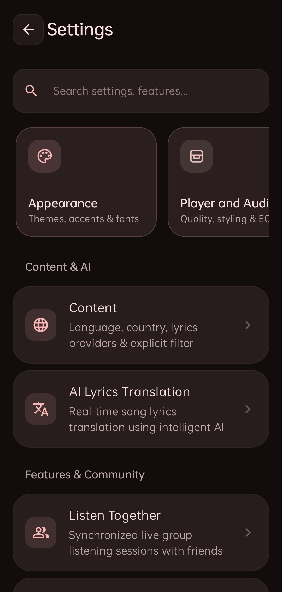

<p align="center">
  
</p>

<p align="center">
  <a href="https://mkr-infinity.github.io/mkr-music-web" target="_blank"></a>
  <a href="https://github.com/mkr-infinity/mkr-music/releases/latest/download/mkr-music-universal.apk"></a>
  <a href="https://github.com/mkr-infinity"></a>
  
</p>

<div align="center">

# MKR Music

### *Not just a music player — an intelligent, private sonic sanctuary.*

**MKR Music**  is a premier open-source music streaming and offline audio player for Android.
Unifying **YouTube Music** and **Spotify playlist sync**, it delivers studio-grade lossless sound up to 320 kbps, synchronized lyrics, dynamic canvas visuals, and smart mood queues — completely ad-free and 100% private forever.


<br/>

<p align="center">
  <a href="https://mkr-infinity.github.io/mkr-music-web" target="_blank">
    
  </a>
  <br/><br/>
  <a href="https://github.com/mkr-infinity/mkr-music/releases/latest/download/mkr-music-universal.apk">
    
  </a>
  &nbsp;&nbsp;
  <a href="https://github.com/mkr-infinity/mkr-music/releases/latest">
    
  </a>
</p>

<p align="center">
  <sub>✨ <b>Direct APK Download:</b> The green button above automatically downloads <code>mkr-music-universal.apk</code> from the latest release.<br/>
  🌐 <b>Official Website:</b> Check out <a href="https://mkr-infinity.github.io/mkr-music-web"><b>mkr-infinity.github.io/mkr-music-web</b></a> for interactive visualizers, audio feature showcases, and screenshot galleries!</sub>
</p>

</div>

---

## 📱 Screenshots Showcase

<table align="center" width="100%">
  <tr>
    <td align="center" width="50%">
      <h4>🏠 Home</h4>
      
    </td>
    <td align="center" width="50%">
      <h4>🔍 Search</h4>
      
    </td>
  </tr>
  <tr>
    <td align="center" width="50%">
      <h4>🎵 Now Playing</h4>
      
    </td>
    <td align="center" width="50%">
      <h4>🌌 Immersive View</h4>
      
    </td>
  </tr>
  <tr>
    <td align="center" width="50%">
      <h4>📜 Synced Lyrics</h4>
      
    </td>
    <td align="center" width="50%">
      <h4>👤 Artist Profile</h4>
      
    </td>
  </tr>
  <tr>
    <td align="center" width="50%">
      <h4>🔊 Audio Output</h4>
      
    </td>
    <td align="center" width="50%">
      <h4>⚙️ Settings</h4>
      
    </td>
  </tr>
</table>


---

## ✨ Key Features

- 🎧 **Tri-Engine Streaming & Sync** – YouTube Music, JioSaavn, and Spotify playlist integration with lossless playback.
- 🎚️ **MKR Studio Equalizer** – 10-band precision EQ, Dolby Atmos simulation, bass boost, and audio presets.
- 📜 **Synchronized Lyrics** – Live word-by-word scrolling lyrics with dynamic animated glow and blurred backdrops.
- 🧠 **Mood Queue & Quick Picks** – Smart track recommendations matching your active mood and listening taste.
- ⚡ **Instant Playback & Smart Cache** – Zero-buffer audio playback with automated offline caching (5s–90s).
- 🎨 **Expressive Material 3 UI** – Full-bleed dynamic canvas visuals, fluid transitions, and 5 custom adaptive icons.
- 👥 **Listen Together** – Synchronized listening rooms to stream music in real-time with friends.
- 🎵 **Bitrate & Output Switcher** – Live kbps stream quality badges and instant Bluetooth audio routing.
- 🛡️ **Zero Telemetry & 100% Private** – Open-source, no trackers, no ads, and all library data stored locally.
- 🚀 **More to Explore** – Sleep timer, Discord Rich Presence, backup/restore, and persistent playback.

---

> ### 💖 Support the Project
>
> If you love **MKR Music** and want to support its maintenance and active development, please consider buying me a coffee! Your support helps keep this premium audio experience completely active, clean, and ad-free.
>
> <a href="https://buymeacoffee.com/mkr_infinity"></a>

---

## 🤝 Contributing

Contributions make the open-source community an incredible place to learn, inspire, and create. Any contributions you make are **greatly appreciated**!

1. **Fork the Project**
2. **Create your Feature Branch**
   ```bash
   git checkout -b feature/AmazingFeature
   ```
3. **Commit your Changes**
   ```bash
   git commit -m "feat: add amazing feature/your feature added"
   ```
4. **Push to the Branch**
   ```bash
   git push origin feature/AmazingFeature
   ```
5. **Open a Pull Request**

---

## 🛡️ Privacy & Data Protection

Your privacy is fundamental:
- 🚫 **Zero Data Collection**: MKR Music collects absolutely no personal data, diagnostics, or usage metrics.
- 🕵️ **No Third-Party Trackers**: Zero advertising SDKs, tracking pixels, or telemetry services.
- 📱 **Device-Only Storage**: All listening history, playlists, cached songs, and preferences reside strictly on your local device.

---

## ⚠️ Disclaimer

**MKR Music** is an independent open-source project developed solely by **Mohammad Kaif Raja**.
- MKR Music is **not affiliated with, endorsed by, sponsored by, or funded by Google LLC, YouTube, JioSaavn, or any of their subsidiaries**.
- All music content, audio streams, logos, artist names, and trademarks belong to their respective copyright owners.
- This software is distributed strictly for personal, educational, and non-commercial use under the GPL-3.0 license.

---

## 👨‍💻 Developer & Connect

<div align="center">

Crafted with dedication by **Mohammad Kaif Raja**:

[](https://mkr-infinity.github.io/mkr-music-web)
[](https://mkr-infinity.github.io)
[](https://github.com/mkr-infinity)
[](https://github.com/mkr-infinity/mkr-music)
[](https://www.instagram.com/mkr_infinity)
[](https://t.me/mkr_infinity)
[](https://buymeacoffee.com/mkr_infinity)

</div>

---

## 🙏 Special Thanks & Credits

**MKR Music** is built upon the foundation of amazing open-source projects, visionary developers, and the broader FLOSS community:


- **[ViMusic](https://github.com/vfsfitvnm/ViMusic)** by vfsfitvnm – For pioneering the original Android client and playback concepts.
- **[ViVi Music](https://github.com/vivizzz007/vivi-music)** by vivizzz007 – For inspiring features, UI refinements, and dedicated contributions.
- **[InnerTune](https://github.com/z-huang/InnerTune)** by Zion Huang – For the groundbreaking YouTube Music client architecture and Innertube integration foundation.
- **[AM-Lyrics](https://github.com/Binimum)** – For the powerful synced TTML lyrics integration from Binimum.
- **[Better Lyrics](https://github.com/Better-Lyrics)** – For beautiful synchronized lyrics and YouTube Music integration.
- **[YouLyPlus](https://github.com/YouLyPlus)** – For smooth, expressive in-app lyrics styling.
- **[Unison](https://github.com)** – For the premium Apple Music-style visualizer canvas.
- **[SponsorBlock](https://sponsor.ajay.app/)** – For automatic skipping of sponsored and non-music segments.
- **Spotify Integration** – For Spotify playlist discovery, search queries, and audio library synchronization.
- **JioSaavn Integration** – For high-fidelity regional streaming and catalog fallback.
- **Innertube & NewPipe Extractor** – For YouTube Music streaming APIs, stream extraction, and search pipelines.

> To the open-source community: Thank you for all the incredible tools, libraries, and APIs that make this project possible!
>
> *Thank you to all the amazing developers who made this project possible!*

---

<div align="center">

## ⚖️ License

MKR Music is open-source software licensed under the [GNU General Public License v3.0 (GPL-3.0)](LICENSE).

*Copyright © 2026 Mohammad Kaif Raja ([@mkr-infinity](https://github.com/mkr-infinity))*

</div>
