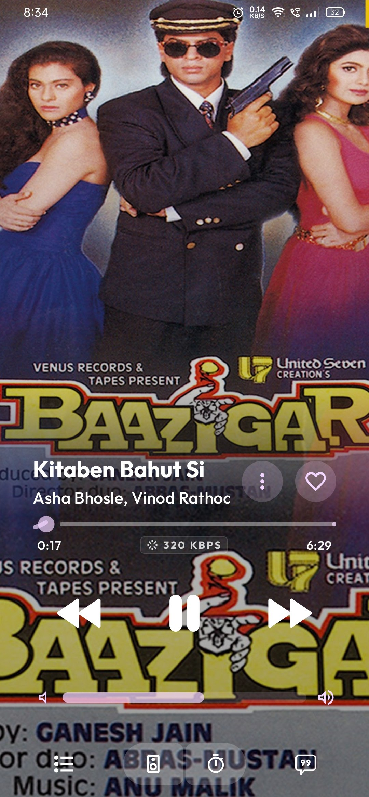
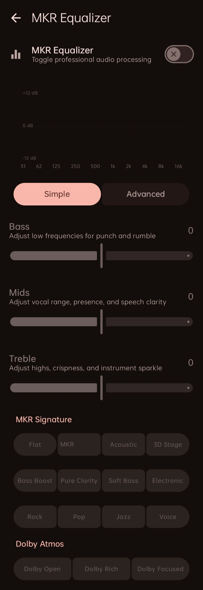
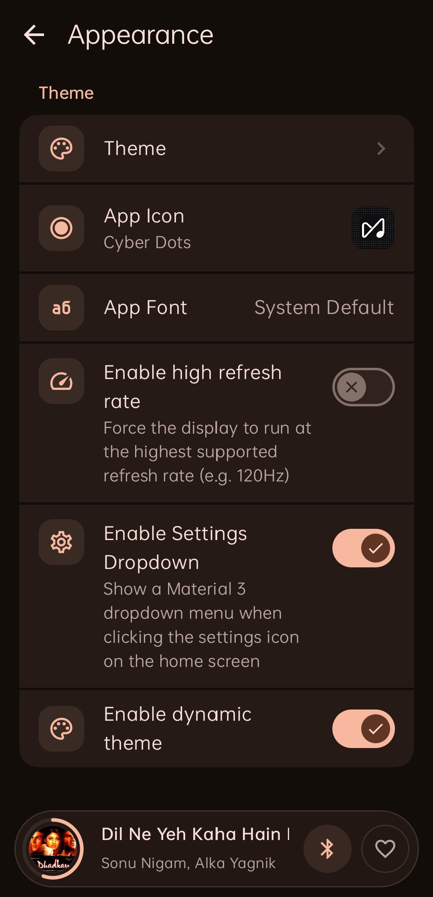
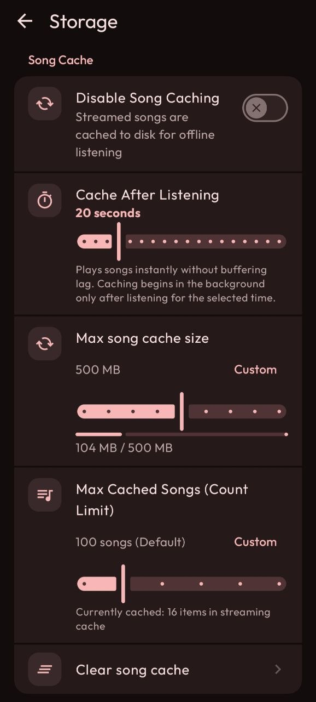

<p align="center">
  
</p>

<p align="center">
  <a href="https://github.com/mkr-infinity/mkr-music/releases/latest"></a>
  <a href="https://github.com/mkr-infinity"></a>
  
</p>

<div align="center">

# 🎵 MKR Music

### *Not just a music player — an intelligent, private sonic sanctuary.* ✨

**MKR Music** is a premier open-source music streaming and offline audio player for Android.
Unifying **YouTube Music**, **JioSaavn**, and **Spotify playlist sync**, it delivers studio-grade lossless sound up to 320 kbps, synchronized lyrics, dynamic canvas visuals, and smart mood queues — completely ad-free and 100% private.

<p align="center">
  <a href="https://github.com/mkr-infinity/mkr-music/releases/latest">
    
  </a>
</p>

<p align="center">
  <sub><em>💡 <b>Note:</b> After clicking the button above, scroll down to the <b>Assets</b> section on the release page to download the APK file.</em></sub>
</p>

</div>

---

## 📱 Screenshots Showcase

<table align="center" width="100%">
  <tr>
    <td align="center" width="33%" valign="top">
      <h4>🏠 Home</h4>
      
    </td>
    <td align="center" width="33%" valign="top">
      <h4>🔍 Search</h4>
      
    </td>
    <td align="center" width="33%" valign="top">
      <h4>🎵 Now Playing</h4>
      
    </td>
  </tr>
  <tr>
    <td align="center" width="33%" valign="top">
      <h4>🌌 Immersive View</h4>
      
    </td>
    <td align="center" width="33%" valign="top">
      <h4>🎬 Dynamic Canvas</h4>
      
    </td>
    <td align="center" width="33%" valign="top">
      <h4>📜 Synced Lyrics</h4>
      
    </td>
  </tr>
  <tr>
    <td align="center" width="33%" valign="top">
      <h4>👤 Artist Profile</h4>
      
    </td>
    <td align="center" width="33%" valign="top">
      <h4>🎚️ Studio Equalizer</h4>
      
    </td>
    <td align="center" width="33%" valign="top">
      <h4>🔊 Audio Output</h4>
      
    </td>
  </tr>
  <tr>
    <td align="center" width="33%" valign="top">
      <h4>⚙️ Settings</h4>
      
    </td>
    <td align="center" width="33%" valign="top">
      <h4>🎭 Appearance</h4>
      
    </td>
    <td align="center" width="33%" valign="top">
      <h4>💾 Storage & Cache</h4>
      
    </td>
  </tr>
</table>

---

## ✨ Key Features

| # | Feature | Description |
| :-: | :--- | :--- |
| 1 | 🎧 **Tri-Engine Streaming & Sync** | Lossless audio powered by YouTube Music, JioSaavn, and Spotify playlist integration & sync with seamless fallback. |
| 2 | 🎚️ **MKR Studio Equalizer** | Studio acoustic tuning with 10-band EQ, Bass/Mids/Treble sliders, Dolby Atmos, and signature presets. |
| 3 | 📜 **Synchronized Lyrics** | Real-time word-by-word scrolling lyrics with dynamic animated glow and blurred album art backdrops. |
| 4 | 🧠 **Smart Mood Queue & Quick Picks** | Intelligent track radio clustering that adapts to your active listening taste, recent mood, and genre. |
| 5 | ⚡ **Instant Playback & Smart Cache** | Instant zero-buffer audio start with customizable delayed caching (5s–90s) for offline listening. |
| 6 | 🎨 **Expressive Material 3 UI** | Full-bleed artwork canvases, fluid animations, and 12 custom adaptive launcher icons. |
| 7 | 👥 **Listen Together** | Real-time synchronized listening rooms allowing you and your friends to stream music together remotely. |
| 8 | 🎵 **Stream Bitrate & Output Switcher** | Dynamic real-time kbps stream quality reporting with seamless Bluetooth and device audio routing. |
| 9 | 🛡️ **Zero Telemetry & 100% Private** | Completely open-source, zero analytics or telemetry, no ads, and all library data stored locally. |
| 10 | 🚀 **Explore More Features** | [**Download the App**](https://github.com/mkr-infinity/mkr-music/releases/latest) to enjoy Discord Rich Presence, Sleep Timer, Library Backups, and more! |

---

> ### 💖 Support the Project
>
> If you love **MKR Music** and want to support its maintenance and active development, please consider buying me a coffee! Your support helps keep this premium audio experience completely active, clean, and ad-free.
>
> <a href="https://buymeacoffee.com/mkr_infinity"></a>

---

## 🤝 Contributing

Contributions make the open-source community an incredible place to learn, inspire, and create. Any contributions you make are **greatly appreciated**!

1. **Fork the Project**
2. **Create your Feature Branch**
   ```bash
   git checkout -b feature/AmazingFeature
   ```
3. **Commit your Changes**
   ```bash
   git commit -m "feat: add amazing feature"
   ```
4. **Push to the Branch**
   ```bash
   git push origin feature/AmazingFeature
   ```
5. **Open a Pull Request**

---

## 🛡️ Privacy & Data Protection

Your privacy is fundamental:
- 🚫 **Zero Data Collection**: MKR Music collects absolutely no personal data, diagnostics, or usage metrics.
- 🕵️ **No Third-Party Trackers**: Zero advertising SDKs, tracking pixels, or telemetry services.
- 📱 **Device-Only Storage**: All listening history, playlists, cached songs, and preferences reside strictly on your local device.

---

## ⚠️ Disclaimer

**MKR Music** is an independent open-source project developed solely by **Mohammad Kaif Raja**.
- MKR Music is **not affiliated with, endorsed by, sponsored by, or funded by Google LLC, YouTube, JioSaavn, or any of their subsidiaries**.
- All music content, audio streams, logos, artist names, and trademarks belong to their respective copyright owners.
- This software is distributed strictly for personal, educational, and non-commercial use under the GPL-3.0 license.

---

## 👨‍💻 Developer & Connect

<div align="center">

Crafted with dedication by **Mohammad Kaif Raja**:

[](https://mkr-infinity.github.io)
[](https://github.com/mkr-infinity)
[](https://github.com/mkr-infinity/mkr-music)
[](https://www.instagram.com/mkr_infinity)
[](https://t.me/mkr_infinity)
[](https://buymeacoffee.com/mkr_infinity)

</div>

---

## 🙏 Special Thanks & Credits

**MKR Music** is built upon the foundation of amazing open-source projects, visionary developers, and the broader FLOSS community:

### 💡 Special Thanks
- **Mostafa Alagamy** – Creator of [Metrolist](https://github.com/mostafaalagamy/metrolist), the project that inspired the original foundation. Huge thanks for the foundation and open-source contributions! 🌟
- **[@Zemer](https://github.com/Zemer)** – Huge congratulations and thanks for inventing the revolutionary playback method! 🎉

### 🎖️ Foundational Projects
- **[InnerTune](https://github.com/z-huang/InnerTune)** by Zion Huang – For the groundbreaking YouTube Music client architecture and Innertube integration foundation.
- **[ViMusic](https://github.com/vfsfitvnm/ViMusic)** by vfsfitvnm – For pioneering the original Android client and playback concepts.
- **[ViVi Music](https://github.com/vivizzz007/vivi-music)** by vivizzz007 – For inspiring features, UI refinements, and dedicated contributions.
- **[AM-Lyrics](https://github.com/Binimum)** – For the powerful synced TTML lyrics integration from Binimum.
- **[Better Lyrics](https://github.com/Better-Lyrics)** – For beautiful synchronized lyrics and YouTube Music integration.
- **[YouLyPlus](https://github.com/YouLyPlus)** – For smooth, expressive in-app lyrics styling.
- **[Unison](https://github.com)** – For the premium Apple Music-style visualizer canvas.
- **[SponsorBlock](https://sponsor.ajay.app/)** – For automatic skipping of sponsored and non-music segments.
- **Spotify Integration** – For Spotify playlist discovery, search queries, and audio library synchronization.
- **JioSaavn Integration** – For high-fidelity regional streaming and catalog fallback.
- **Innertube & NewPipe Extractor** – For YouTube Music streaming APIs, stream extraction, and search pipelines.

> 💖 **To the open-source community:** Thank you for all the incredible tools, libraries, and APIs that make this project possible!
> 
> *Thank you to all the amazing developers who made this project possible!* ✨

---

<div align="center">

## ⚖️ License

MKR Music is open-source software licensed under the [GNU General Public License v3.0 (GPL-3.0)](LICENSE).

*Copyright © 2026 Mohammad Kaif Raja ([@mkr-infinity](https://github.com/mkr-infinity))*

</div>
