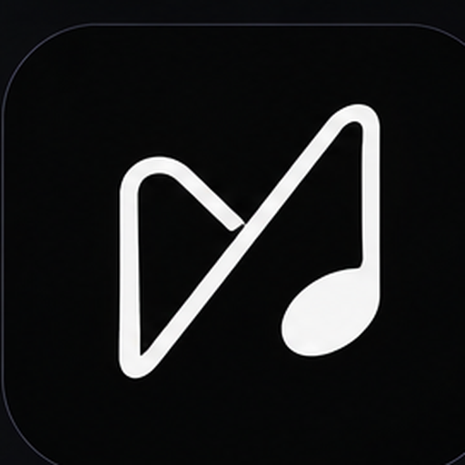
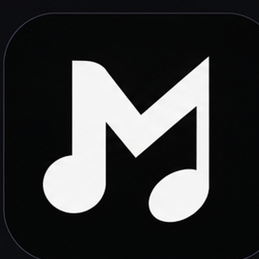
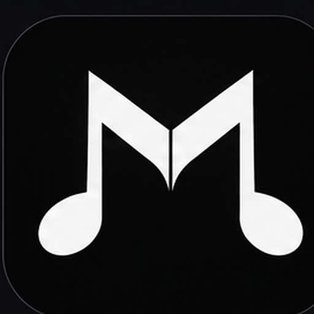
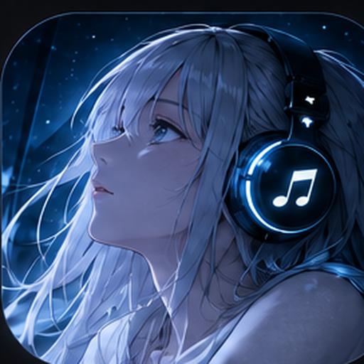

  

<h1 align="center">MKR Music</h1>

  <strong>An elegant, lightweight, and modern music player for Android.</strong> 
  Crafted with Jetpack Compose, Material 3 Expressive, and Media3 ExoPlayer.

  
  
  
  
  

---

## 📖 Overview

**MKR Music** is a high-performance, ad-free Android music player developed by **Mohammad Kaif Raja ([@mkr-infinity](https://github.com/mkr-infinity))**. It combines modern Android architecture with an expressive Material 3 interface, instant music discovery, real-time synchronized lyrics, offline audio caching, and rich personalized acoustics.

Whether you're streaming top charts or listening to cached playlists on the go, MKR Music is engineered to stay snappy and lightweight—even on older devices.

---

## ✨ Features at a Glance

- 🎧 **High-Fidelity Playback**: Powered by AndroidX Media3 ExoPlayer with gapless playback, crossfade, and background streaming.
- 📶 **Smart Offline Caching**: Automatic caching of streamed tracks so you can seamlessly replay your listening history offline without wasting mobile data.
- 📜 **Synchronized Lyrics**: Fluid word-by-word and line-by-line synced lyrics powered by LRCLIB, KuGou, and BetterLyrics providers.
- 🎚️ **MKR Equalizer**: Pro-grade acoustic tuning with presets including MKR Signature, Bass Boost, 3D Stage, Dolby Atmos, and Dirac Audio.
- 📊 **Listening Summary & Musical Moods**: Weekly listening stats with smart musical mood analysis (*Melancholic, High Voltage, Chill, Romantic, Playful, Eclectic*).
- 🎨 **Dynamic Theming**: Full Material You dynamic color extraction, customizable accent palettes, and true AMOLED pure black mode.
- 🎭 **9 Selectable App Icons**: Choose between Music silhouettes, Anime boys, and Anime girls directly from the Appearance settings.
- 👥 **Listen Together**: Synchronized real-time listening sessions with friends.
- 🧹 **Stop Music on Task Clear**: Free system memory immediately on swiping the app from recent tasks.
- 🥚 **Hidden Easter Egg**: Tap the top-left logo on the home screen to unlock quirky responses!

---

## 🎨 Selectable App Icons

MKR Music features nine distinct launcher icon identities crafted directly from the official showcase sheet:

| Line Note *(Default)* | M Note | Music Monogram |
| :---: | :---: | :---: |
|  |  |  |
| **Gojo Inspired** | **Thorfinn Inspired** | **Anime Boy (Original)** |
|  |  |  |
| **Suzuka Inspired** | **Anime Girl (Red)** | **Anime Girl (Blue)** |
|  |  |  |

---

## 📱 System Requirements

| Specification | Requirement |
| :--- | :--- |
| **Minimum OS** | Android 8.0 (API Level 26) |
| **Target OS** | Android 15 / 16 (API Level 35+) |
| **Supported ABIs** | `arm64-v8a`, `armeabi-v7a`, `x86`, `x86_64` |
| **RAM Requirement** | Optimized for devices with 2GB RAM or higher |

---

## 📦 Distribution Variants

- **GMS Variant (`universalGms`)**: Includes Google Play Services and Google Cast support for casting music to Chromecasts, smart speakers, and smart displays.
- **FOSS Variant (`universalFoss`)**: 100% Google Play Services-free, privacy-respecting, and compatible with F-Droid.

---

## 🚀 Building & Releases via GitHub Actions

To guarantee reproducibility and clean builds without local environment issues, MKR Music is configured to build exclusively on GitHub Actions:

1. Navigate to the **[Actions tab](https://github.com/mkr-infinity/mkr-music/actions)**.
2. Select the **CI & Debug Build** workflow.
3. Click **Run workflow** on the `main` branch.
4. Download the compiled universal APK artifacts directly from the workflow run.

---

## 🛠️ Architecture & Tech Stack

- **UI Framework**: [Jetpack Compose](https://developer.android.com/jetpack/compose) with Material 3 Expressive
- **Audio Engine**: [AndroidX Media3](https://developer.android.com/media/media3) ExoPlayer & MediaSession
- **Dependency Injection**: [Hilt](https://dagger.dev/hilt/)
- **Database & Preferences**: [Room Database](https://developer.android.com/training/data-storage/room) & Jetpack DataStore Preferences
- **Networking**: [Ktor](https://ktor.io/) & OkHttp with Kotlinx Serialization
- **Image Pipeline**: [Coil 3](https://coil-kt.github.io/coil/) with memory optimizations for low-RAM devices

---

## 👨‍💻 Developer & Connect

Developed with ❤️ by **Mohammad Kaif Raja**:

- 🌐 **Developer Website**: [https://mkr-infinity.github.io](https://mkr-infinity.github.io)
- 🐙 **GitHub Profile**: [@mkr-infinity](https://github.com/mkr-infinity)
- 📦 **Project Repository**: [https://github.com/mkr-infinity/mkr-music](https://github.com/mkr-infinity/mkr-music)
- 📸 **Instagram**: [@mkr_infinity](https://www.instagram.com/mkr_infinity)
- ✈️ **Telegram**: [@mkr_infinity](https://t.me/mkr_infinity)
- ☕ **Support Development**: [Buy Me a Coffee](https://buymeacoffee.com/mkr_infinity)

---

## 🙏 Credits & Inspiration

MKR Music was inspired by and builds upon the ideas and codebases of these open-source projects:

- **ViVi Music**: Created with passion by **vivizzz007** and community contributors. Sincere thanks for the wonderful inspiration and foundations!
- **InnerTune**: Developed by **Zion Huang** and contributors.
- **ViMusic**: Developed by **vfsfitvnm** and contributors.

---

## ⚖️ License

MKR Music is licensed under the [GNU General Public License v3.0 (GPL-3.0)](LICENSE) with special exceptions for included API connectors.
