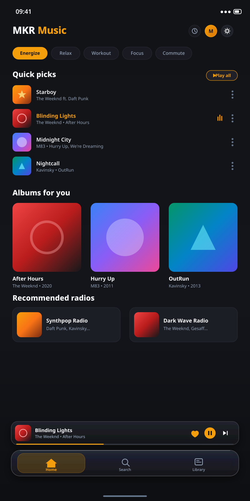

<p align="center">
  
</p>

<p align="center">
  <a href="https://github.com/mkr-infinity/mkr-music/releases/latest"></a>
  <a href="https://mkr-infinity.github.io/mkr-music-web" target="_blank"></a>
  <a href="https://github.com/mkr-infinity/mkr-music/releases/latest/download/mkr-music-universal.apk"></a>
  <a href="https://github.com/mkr-infinity"></a>
  
  <a href="LICENSE"></a>
</p>

<div align="center">

# MKR Music

### *Not just a music player — an intelligent, private sonic sanctuary.*

**MKR Music** is a premier open-source music streaming and offline audio player for Android.
Powered by **YouTube Music** and seamless **Spotify playlist sync**, it delivers studio-grade audio streaming, synchronized lyrics, dynamic artwork presentation, four distinct selectable navigation experiences, and smart mood queues — completely ad-free and 100% private.

<br/>

<p align="center">
  <a href="https://mkr-infinity.github.io/mkr-music-web" target="_blank">
    
  </a>
  <br/><br/>
  <a href="https://github.com/mkr-infinity/mkr-music/releases/latest/download/mkr-music-universal.apk">
    
  </a>
  &nbsp;&nbsp;
  <a href="https://github.com/mkr-infinity/mkr-music/releases/latest">
    
  </a>
</p>

<p align="center">
  <sub><b>Direct APK Download:</b> The green button above automatically downloads <code>mkr-music-universal.apk</code> from the latest release.<br/>
  <b>Official Website:</b> Check out <a href="https://mkr-infinity.github.io/mkr-music-web"><b>mkr-infinity.github.io/mkr-music-web</b></a> for interactive visualizers, audio feature showcases, and screenshot galleries!</sub>
</p>

</div>

---

## Screenshots Showcase

<table align="center" width="100%">
  <tr>
    <td align="center" width="33%" valign="top">
      <h4>Home</h4>
      
    </td>
    <td align="center" width="33%" valign="top">
      <h4>Search</h4>
      
    </td>
    <td align="center" width="33%" valign="top">
      <h4>Now Playing</h4>
      
    </td>
  </tr>
  <tr>
    <td align="center" width="33%" valign="top">
      <h4>Immersive View</h4>
      
    </td>
    <td align="center" width="33%" valign="top">
      <h4>Navigation Styles</h4>
      
    </td>
    <td align="center" width="33%" valign="top">
      <h4>Synced Lyrics</h4>
      
    </td>
  </tr>
  <tr>
    <td align="center" width="33%" valign="top">
      <h4>Artist Profile</h4>
      
    </td>
    <td align="center" width="33%" valign="top">
      <h4>Audio Output</h4>
      
    </td>
    <td align="center" width="33%" valign="top">
      <h4>Settings</h4>
      
    </td>
  </tr>
  <tr>
    <td align="center" width="33%" valign="top">
      <h4>Appearance</h4>
      
    </td>
    <td align="center" width="33%" valign="top">
      <h4>Storage & Cache</h4>
      
    </td>
    <td align="center" width="33%" valign="top">
      <h4>Studio Equalizer</h4>
      
    </td>
  </tr>
</table>

---

## Key Features

- **Streaming & Playlist Sync** – YouTube Music streaming with lossless caching and Spotify playlist integration.
- **Four Selectable Navigation Styles** – Choose between Floating Glass Bar, Expressive Pill, Material 3 Expressive, and Amber Minimal Dock with persistent preference.
- **Global Dynamic Artwork Theming** – Real-time color extraction harmonizes backgrounds, navigation docks, sliders, and lyrics to match current track artwork.
- **MKR Studio Equalizer** – 10-band precision EQ, Dolby Atmos simulation, bass boost, and custom audio profiles.
- **Synchronized Lyrics** – Live word-by-word scrolling lyrics with animated glow, tap-to-seek, and bilingual translation support.
- **Mood Queue & Quick Picks** – Smart track recommendations matching your active mood and listening taste.
- **Instant Playback & Smart Cache** – Zero-buffer audio playback with automated offline caching (5s–90s configurable threshold).
- **Dedicated Listen Together Server** – Synchronized group listening rooms powered by the custom hosted server (`https://listen-together-mkr-music.onrender.com`).
- **Bitrate & Output Switcher** – Live kbps stream quality badges and instant Bluetooth audio routing.
- **Zero Telemetry & 100% Private** – Open-source, no trackers, no ads, and all library data stored locally.
- **More to Explore** – Sleep timer, Discord Rich Presence, backup/restore, and persistent playback queue.

---

## Architecture & Versioning

MKR Music uses a single source of truth for version management:
- **Canonical Version File**: `version.properties` at project root defines `APP_VERSION=1.0.0`.
- **Deterministic Monotonic Version Code**: Computed via `MAJOR * 10000 + MINOR * 100 + PATCH` (`versionCode = 10000`), ensuring continuous monotonic upgrade compatibility over historical builds.
- **Automated CI/CD**: GitHub Actions workflow (`.github/workflows/release.yml`) compiles, signs, verifies, and packages single Universal APKs (`mkr-music-universal.apk`) targeting `arm64-v8a`, `armeabi-v7a`, `x86`, and `x86_64`.
- **Project Roadmap**: See [TODO.md](TODO.md) for master roadmap tracking across Phases 12–19.

---

> ### Support the Project
>
> If you love **MKR Music** and want to support its maintenance and active development, please consider buying me a coffee! Your support helps keep this premium audio experience completely active, clean, and ad-free.
>
> <a href="https://buymeacoffee.com/mkr_infinity"></a>

---

## Contributing

Contributions make the open-source community an incredible place to learn, inspire, and create. Any contributions you make are **greatly appreciated**!

1. **Fork the Project**
2. **Create your Feature Branch**
   ```bash
   git checkout -b feature/AmazingFeature
   ```
3. **Commit your Changes**
   ```bash
   git commit -m "feat: add amazing feature"
   ```
4. **Push to the Branch**
   ```bash
   git push origin feature/AmazingFeature
   ```
5. **Open a Pull Request**

---

## Privacy & Data Protection

Your privacy is fundamental:
- **Zero Data Collection**: MKR Music collects absolutely no personal data, diagnostics, or usage metrics.
- **No Third-Party Trackers**: Zero advertising SDKs, tracking pixels, or telemetry services.
- **Device-Only Storage**: All listening history, playlists, cached songs, and preferences reside strictly on your local device.

---

## Disclaimer

**MKR Music** is an independent open-source project developed solely by **Mohammad Kaif Raja**.
- MKR Music is **not affiliated with, endorsed by, sponsored by, or funded by Google LLC, YouTube, or any of their subsidiaries**.
- All music content, audio streams, logos, artist names, and trademarks belong to their respective copyright owners.
- This software is distributed strictly for personal, educational, and non-commercial use under the GPL-3.0 license.

---

## Developer & Connect

<div align="center">

Crafted with dedication by **Mohammad Kaif Raja**:

[](https://mkr-infinity.github.io/mkr-music-web)
[](https://mkr-infinity.github.io)
[](https://github.com/mkr-infinity)
[](https://github.com/mkr-infinity/mkr-music)
[](https://www.instagram.com/mkr_infinity)
[](https://t.me/mkr_infinity)
[](https://buymeacoffee.com/mkr_infinity)

</div>

---

## Special Thanks & Credits

**MKR Music** is built upon the foundation of amazing open-source projects, visionary developers, and the broader FLOSS community:

### Special Thanks
- **[ViMusic](https://github.com/vfsfitvnm/ViMusic)** by vfsfitvnm – For pioneering the original Android client and playback concepts.
- **[ViVi Music](https://github.com/vivizzz007/vivi-music)** by vivizzz007 – For inspiration, features, and UI refinements.
- **Mostafa Alagamy** – Creator of [Metrolist](https://github.com/mostafaalagamy/metrolist), the project that inspired the original foundation. Huge thanks for the foundation and open-source contributions!
- **[@Zemer](https://github.com/Zemer)** – Congratulations and thanks for inventing the playback method!

### Foundational Projects
- **[InnerTune](https://github.com/z-huang/InnerTune)** by Zion Huang – For the groundbreaking YouTube Music client architecture and Innertube integration foundation.
- **[AM-Lyrics](https://github.com/Binimum)** – For the synced TTML lyrics integration from Binimum.
- **[Better Lyrics](https://github.com/Better-Lyrics)** – For synchronized lyrics and YouTube Music integration.
- **[YouLyPlus](https://github.com/YouLyPlus)** – For smooth in-app lyrics styling.
- **[SponsorBlock](https://sponsor.ajay.app/)** – For automatic skipping of sponsored and non-music segments.
- **Spotify Integration** – For Spotify playlist discovery, search queries, and audio library synchronization.
- **Innertube & NewPipe Extractor** – For YouTube Music streaming APIs, stream extraction, and search pipelines.

> **To the open-source community:** Thank you for all the incredible tools, libraries, and APIs that make this project possible!

---

<div align="center">

## License

MKR Music is open-source software licensed under the [GNU General Public License v3.0 (GPL-3.0)](LICENSE).

*Copyright © 2026 Mohammad Kaif Raja ([@mkr-infinity](https://github.com/mkr-infinity))*

</div>
